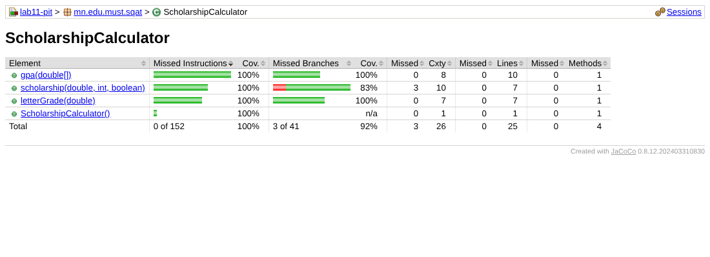

# Лаборатори №11: Mutation testing — PIT-ээр тестийн чанараа хэмжих

F.CSA313 — Программ хангамжийн чанарын баталгаа ба тест (2026)

- **Овог нэр:** О.Мэнд-Амар
- **Оюутны код:** B232270001

## Ажлын орчин

`java -version` ба `mvn -version`-ий гаралт (бүтэн хувилбар: [`results/env.txt`](results/env.txt)):

```
openjdk version "17.0.19" 2026-04-21
OpenJDK Runtime Environment Homebrew (build 17.0.19+0)
OpenJDK 64-Bit Server VM Homebrew (build 17.0.19+0, mixed mode, sharing)
Apache Maven 3.9.16 (2bdd9fddda4b155ebf8000e807eb73fd829a51d5)
Maven home: /opt/homebrew/Cellar/maven/3.9.16/libexec
Java version: 26.0.1, vendor: Homebrew, runtime: /opt/homebrew/Cellar/openjdk/26.0.1/libexec/openjdk.jdk/Contents/Home
Default locale: en_MN, platform encoding: UTF-8
OS name: "mac os x", version: "26.6.2", arch: "aarch64", family: "mac"
```

Тэмдэглэл: shell-ийн `java` нь 17, Maven нь Homebrew-ийн JDK 26 runtime дээр ажилладаг. `pom.xml`-д `maven.compiler.release=17` тул байт код Java 17-ийнх байна.

Хэрэгслүүд: JUnit 5.10.2, JaCoCo 0.8.12, PIT 1.16.1 (+ pitest-junit5-plugin 1.2.1), мутацийн операторууд `STRONGER`.

## Хэрхэн дахин ажиллуулах вэ

```bash
mvn clean verify                                            # тест + JaCoCo тайлан (target/site/jacoco)
mvn test-compile org.pitest:pitest-maven:mutationCoverage   # PIT тайлан (target/pit-reports)
```

---

## 1. Эхний хэмжилт (Starter, тестийг өөрчлөхөөс өмнө)

Нотолгоо: [`results/mvn-verify-start.txt`](results/mvn-verify-start.txt), [`results/jacoco-start.csv`](results/jacoco-start.csv), [`results/pit-start.txt`](results/pit-start.txt)

### JaCoCo



`results/jacoco-start.csv`: `LINE_MISSED=0, LINE_COVERED=25` → **Line 100% (25/25)**; `BRANCH_MISSED=3, BRANCH_COVERED=38` → **Branch 38/41 (92%)**. Дутуу 3 салаа бүгд `scholarship()`-д байгаа (83%).

### PIT


`results/pit-start.txt`-ийн төгсгөл:

```
>> Line Coverage (for mutated classes only): 25/25 (100%)
>> Generated 63 mutations Killed 17 (27%)
>> Mutations with no coverage 0. Test strength 27%
```

**Mutation Coverage = 17/63 (27%)**, амьд үлдсэн мутант 46.

### Ажиглалт: Line Coverage ба Mutation Coverage-ийн зөрүү

Line Coverage 100% байгаа нь кодын мөр бүр тестийн явцад *ажилласан* гэсэн утгатай. Гэхдээ тест тэр мөрийн *үр дүнг шалгасан* эсэхийг хэлдэггүй. Мутант бүр coverage-тэй (`no coverage 0`) атал 63-аас ердөө 17 нь алагдсан. Энэ нь тестүүд кодыг гүйлгэж байгаа ч `assertNotNull`, `assertTrue(0 ≤ x ≤ 100)` гэх мэт сул assertion-ууд буруу утгыг ч "зөв" гэж хүлээн авдгийг харуулж байна. Өөрөөр хэлбэл 73 пунктийн зөрүү бол тестийн багцын *алдаа илрүүлэх чадвар* дутуу байгаагийн хэмжүүр юм.

---

## 2. Хэсэг A: Амьд мутантуудын ангилал

Эх сурвалж: `target/pit-reports/mn.edu.must.sqat/ScholarshipCalculator.java.html` (Starter ажиллагаа). 46 SURVIVED мутантыг мөр ба шалтгаанаар нь бүлэглэв. "Тоо" багана нь тухайн мөрөнд тэр шалтгаанаар амьд үлдсэн мутантын тоо. Нийлбэр нь 46.

Мутацийн тайлбар (PIT 1.16.1, `STRONGER`):
- *changed conditional boundary*: `>=` ↔ `>`, `<` ↔ `<=`
- *removed conditional – replaced comparison check with true*: харьцуулалтын үсрэлтийг хассан, тухайн `if`-ийн нөхцөл үргэлж нэг талдаа ажиллана
- *removed conditional – … with false*: эсрэг тал нь үргэлж ажиллана
- *replaced return value*: буцаах утгыг `""` / `0` / `0.0`-ээр сольсон
- *Replaced double addition with subtraction*: `+=` → `-=`
- *Changed switch default to be first case*: `switch`-ийн default ба эхний case-ийн үсрэх хаягийг сольсон

| Мөр | Мутаци (PIT-ийн тайлбар) | Тоо | Ангилал | Үндэслэл (1 өгүүлбэр) | Арга хэмжээ |
|---|---|---|---|---|---|
| 20 | changed conditional boundary: `score < 0` → `<= 0`, `score > 100` → `>= 100` | 2 | Тест дутуу | 0 ба 100 нь хүчинтэй оролт боловч мутант дээр exception шиддэг, ийм зааг утгын тест байхгүй тул бодит зан төлөв өөрчлөгдөж байгааг хэн ч барихгүй. | B2: `letterGrade(0)="F"`, `letterGrade(100)="A"` |
| 23–27 | replaced return value with `""` (`"A"`,`"B"`,`"C"`,`"D"`,`"F"` → `""`) | 5 | Тест дутуу | `assertNotNull("")` давна. Хоосон мөр бол буруу үсгэн дүн тул зан төлөв өөрчлөгдсөн ч assertion хэт сул. | B1: `assertEquals("A", letterGrade(95))` гэх мэт яг утга |
| 23–26 | removed conditional → true / → false (`score >= 90/80/70/60` бүрт 2) | 8 | Тест дутуу | "true" бол доод мужийн оноо ч дээд үсгийг ("A") буцаана, "false" бол 95 оноо "B" болно. Энэ нь бодит зан төлөвийн өөрчлөлт боловч `assertNotNull` ялгахгүй. | B1: муж бүрийн оноонд яг үсгэн дүн |
| 23–26 | changed conditional boundary: `>= 90/80/70/60` → `> 90/80/70/60` | 4 | Тест дутуу | Яг 90, 80, 70, 60 оноо мутант дээр нэг доод үсэг авдаг (90 → "B"). Тест эдгээр зааг утгыг огт дуудаагүй. | B2: 90/89.99, 80/79.99, 70/69.99, 60/59.99 |
| 36 | Changed switch default to be first case | 1 | Тест дутуу | Мутант "A" дүнг default руу илгээж 4 биш 0 нэмдэг тул голч буурна, гэвч `0 ≤ g ≤ 4` нөхцөл үүнийг ялгахгүй. | B1: `gpa({95,85}) == 3.5`; B2: бүх үсгийг агуулсан массив |
| 38 | Replaced double addition with subtraction (`total += 3` → `-= 3`) | 1 | Тест дутуу | `{95,85}`-ийн голч 3.5 биш 0.5 болдог ч энэ нь [0,4] мужид багтаж assertion давна. | B1: `assertEquals(3.5, …)` |
| 40 | Replaced double addition with subtraction (`total += 1` → `-= 1`) | 1 | Тест дутуу | `{75,65}`-ийн голч 1.5 биш 0.5 болох ч мужийн шалгалт давна. | B1: `assertEquals(1.5, …)` |
| 44 | replaced double return with 0.0d | 1 | Тест дутуу | 0.0 нь [0,4] мужид багтдаг тул ямар ч голчийг 0 болгосон алдааг тест барихгүй. | B1: яг голчийг шалгах |
| 48 | changed conditional boundary: `gpa < 0` → `<= 0`, `credits < 0` → `<= 0` | 2 | Тест дутуу | gpa=0 ба credits=0 нь хүчинтэй оролт боловч мутант exception шиднэ, ийм зааг тест алга. | B2: `scholarship(0.0, 0, false) == 0`, `scholarship(3.0, 0, false) == 50` |
| 48 | removed conditional → true (`gpa < 0` шалгалтын үсрэлт хасагдсан) | 1 | Тест дутуу | Мутант сөрөг голчийг хүлээн авдаг (exception шидэхгүй), гэвч тест зөвхөн 4.1 ба credits=-1-ийг шалгадаг. | B2: `scholarship(-0.01, 10, false)` → IAE |
| 51 | removed conditional → true / → false (`hasViolation`) | 2 | Тест дутуу | "false" бол зөрчилтэй оюутан 100% авна, "true" бол бүх оюутан 0% авна. Хоёулаа [0,100] мужид багтана. | B1: `scholarship(4.0,20,true) == 0`, `scholarship(3.9,16,false) == 100` |
| 52 | replaced int return with 0 (`return 100`) | 1 | Тест дутуу | 100%-ийн тэтгэлгийг 0 болгосон ч `0 ≤ s ≤ 100` давна. | B1: `assertEquals(100, …)` |
| 52 | removed conditional → false: `gpa >= 3.8`, `credits >= 15` | 2 | Тест дутуу | Нөхцөл үргэлж худал бол (3.9, 16) нь 100 биш 70 авна, гэвч мужийн шалгалт ялгахгүй. | B1: яг 100 |
| 52 | removed conditional → true: `gpa >= 3.8`, `credits >= 15` | 2 | Тест дутуу | Нэг нөхцөл нь үргэлж үнэн бол (3.79, 15) эсвэл (3.8, 14) 100 авна. Энэ хослолыг тест дуудаагүй. | B2: `(3.79,15)=70`, `(3.8,14)=70` |
| 52 | changed conditional boundary: `gpa >= 3.8` → `> 3.8`, `credits >= 15` → `> 15` | 2 | Тест дутуу | Яг (3.8, 15) мутант дээр 70 болдог, зааг тест байхгүй. | B2: `(3.8,15)=100` |
| 53 | replaced int return with 0 (`return 70`) | 1 | Тест дутуу | 70%-ийг 0 болгосон ч мужид багтана. | B1: `assertEquals(70, …)` |
| 53 | removed conditional → false: `gpa >= 3.4`, `credits >= 12` | 2 | Тест дутуу | (3.5, 13) нь 70 биш 50 болно, assertion сул. | B1: яг 70 |
| 53 | removed conditional → true: `gpa >= 3.4`, `credits >= 12` | 2 | Тест дутуу | (3.39, 12) эсвэл (3.4, 11) 50 биш 70 авна, тест ийм оролт дуудаагүй. | B2: `(3.39,12)=50`, `(3.4,11)=50` |
| 53 | changed conditional boundary: `>= 3.4` → `> 3.4`, `>= 12` → `> 12` | 2 | Тест дутуу | Яг (3.4, 12) мутант дээр 70 биш 50 болно. | B2: `(3.4,12)=70` |
| 54 | replaced int return with 0 (`return 50`) | 1 | Тест дутуу | 50%-ийг 0 болгосон ч мужид багтана. | B1: `assertEquals(50, …)` |
| 54 | removed conditional → true / → false (`gpa >= 3.0`) | 2 | Тест дутуу | "true" бол 2.0 голчтой оюутан 50% авна, "false" бол 3.1 голчтой оюутан 0% авна. Хоёулаа мужид багтана. | B1: `(3.1,5)=50`, `(2.0,1)=0` |
| 54 | changed conditional boundary: `gpa >= 3.0` → `> 3.0` | 1 | Тест дутуу | Яг 3.0 голч мутант дээр 0 болно, зааг тест байхгүй. | B2: `(3.0, 0)=50`, `(2.99, 20)=0` |
| | **Нийт** | **46** | **Тест дутуу 46, Equivalent 0** | | |

**Equivalent мутант байхгүй гэсэн дүгнэлтийн үндэслэл.** Дээрх 46 мутант бүрийн хувьд гаралт нь эх кодоос ялгарах тодорхой оролтыг хүснэгтийн «Арга хэмжээ» баганад нэрлэсэн. Тухайлбал `double`-ийн зааг утга (90.0, 3.8, 3.4, 3.0) нь кодын литералтай яг адил давхар нарийвчлалтай утга тул `>=` ба `>` хоёр тэр цэг дээр заавал өөр үр дүн өгнө. Ийм ялгах оролт олдож байгаа бол тухайн мутант equivalent биш, харин тест дутуу гэсэн үг. Иймд B хэсгийн дараа бүх мутант алагдах ёстой гэсэн таамаглал дэвшүүлж, үүнийг PIT-ээр шалгана.

Хоёр бүлэг ажиглагдав:
- **Assertion сул (B1-ээр засна): 28 мутант.** Эдгээр нь *replaced return value*, *addition → subtraction*, *switch* болон одоо байгаа оролтоор ялгагдах *removed conditional* мутантууд. Тест кодыг аль хэдийн зөв оролтоор дуудаж байгаа ч үр дүнг нь шалгадаггүй.
- **Зааг/оролт дутуу (B2-оор засна): 18 мутант.** Эдгээр нь *changed conditional boundary* бүгд, мөн одоогийн оролтоор ялгагдахгүй *removed conditional → true* мутантууд (мөр 48, 52, 53). Хүчтэй assertion ч гэсэн тохирох оролт дуудагдахгүй бол тэдгээрийг алж чадахгүй.
